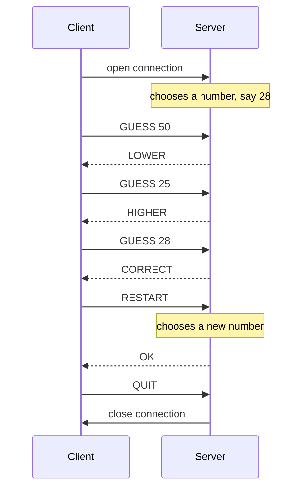
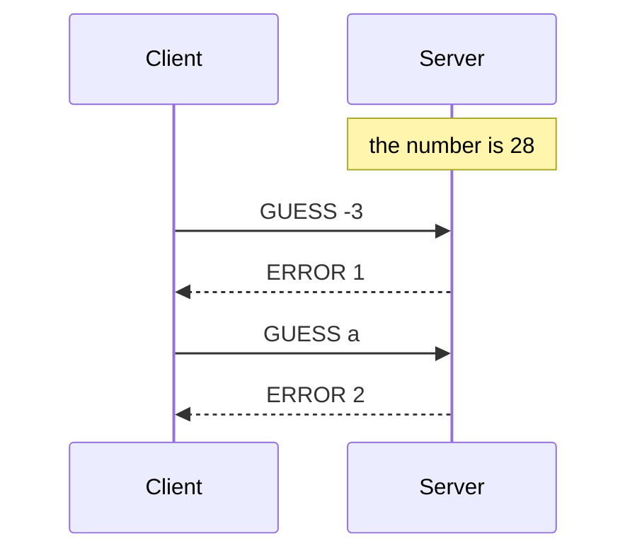
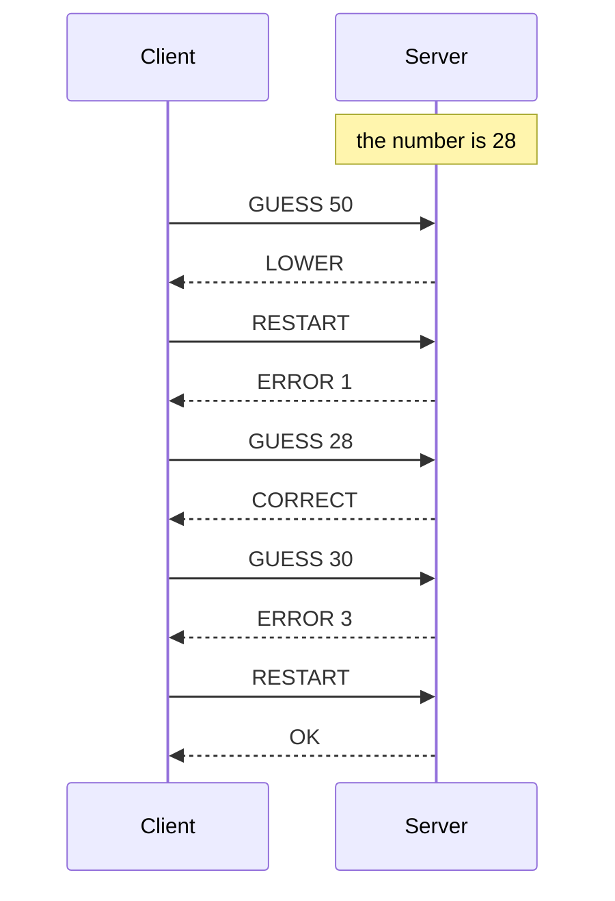
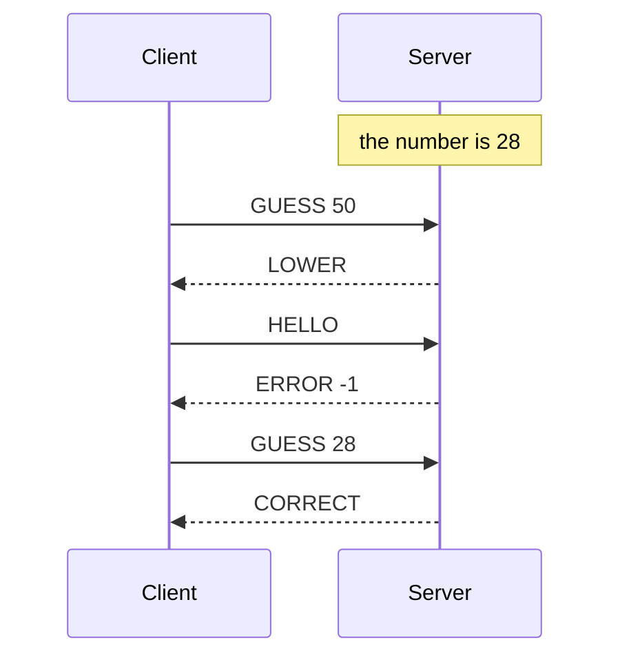

# The *"Guess the number"* protocol

> You are working for a game company that wants to create a new game
> called *"Guess the number"*.
>
> The game is simple: the server generates a random number between 1
> and 100 (inclusive).
>
> The client has to guess the number. The server will respond with a
> message to indicate if the number is higher, lower or correct than the
> number guessed by the client.
>
> Once the client has guessed the number, the client can ask the server
> to restart the game or to quit the game.

Here is one of the possible results. The game works over TCP as well as
over UDP; this specification chooses TCP.

## Section 1 - Overview

The *"Guess the number"* protocol lets a client guess a number chosen
at random by the server, with a hint after each guess.

## Section 2 - Transport protocol

The protocol uses TCP. The server listens on port 6433.

Every message is encoded in UTF-8 and ends with a newline character
(`\n`). Parameters are separated by a single space. Keywords are
written in capitals, and are case-sensitive.

The client opens the connection. The server then chooses a number
between 1 and 100 (inclusive), and the client speaks first, with its
first guess.

The server checks that each guess is a number, between 1 and 100. If it
is, it answers whether the number to find is lower, higher, or equal to
the guess. Otherwise it answers with an error that says which condition
failed.

Once the number is found, the client sends `RESTART` to play again, or
`QUIT` to stop.

On an unknown message, or a message with missing, extra or invalid
parameters,
the server answers `ERROR -1`, and the connection stays open.

The client can send `QUIT` at any time. The server then closes the
connection, which closes it on the client side too. If the client
closes the connection without `QUIT`, the server ends the game and
closes its side.

> [!NOTE]
>
> Either side can close a TCP connection. The SMS protocol lets the
> client close it; this one has the client ask the server to close it.
> Both choices work, as long as the specification states one.

## Section 3 - Messages

### Guess a number

The client sends the number it thinks the server has chosen.

#### Request

```text
GUESS <number>
```

- `number`: the guess, an integer written in decimal digits, with an
  optional `-` sign.

#### Response

- `LOWER`: the number to find is lower than the guess.
- `HIGHER`: the number to find is higher than the guess.
- `CORRECT`: the guess is the number. The game is over.
- `ERROR <code>`: the guess was not taken into account. Codes:
  - `1`: the number is not between 1 and 100.
  - `2`: the guess is not an integer (`a`, `50.5`).
  - `3`: the game is over; send `RESTART` or `QUIT`.

The server checks the codes in this order, and answers the first one
that applies.

### Restart

Once the number is found, the client starts a new game.

#### Request

```text
RESTART
```

#### Response

- `OK`: the server has chosen a new number, and waits for a `GUESS`.
- `ERROR <code>`: no new game was started. Codes:
  - `1`: a game is still in progress.

### Quit

The client stops playing. The server closes the connection.

#### Request

```text
QUIT
```

#### Response

None.

### Unknown or invalid message

#### Response

- `ERROR -1`: the message is unknown, or has missing, extra or invalid
  parameters.

## Section 4 - Examples

### Functional example



### Invalid guesses



### Restart during a game, guess after the end



### Unknown message


