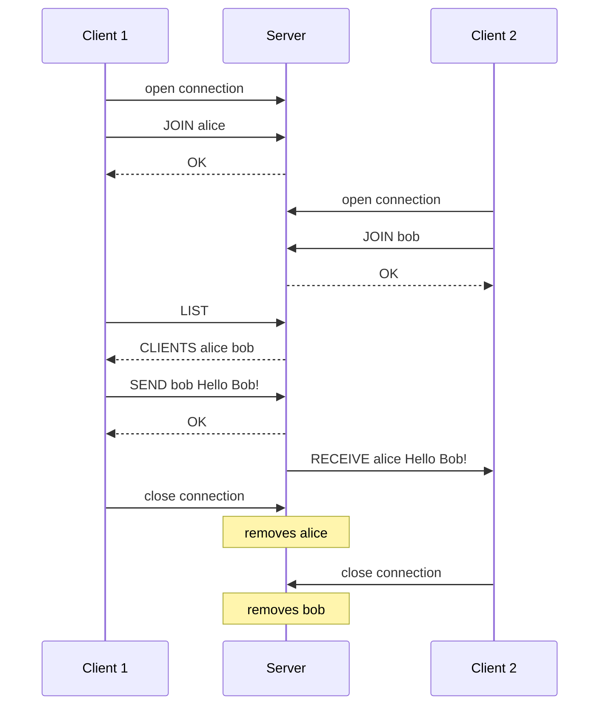
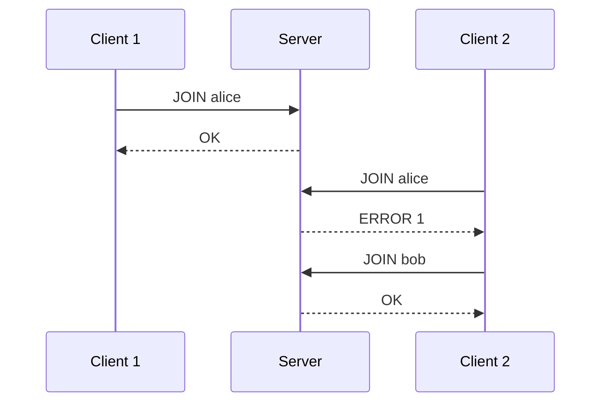
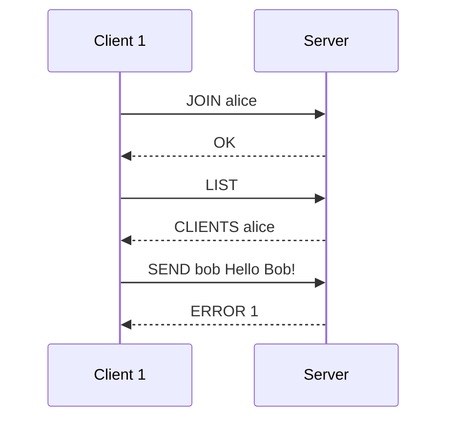
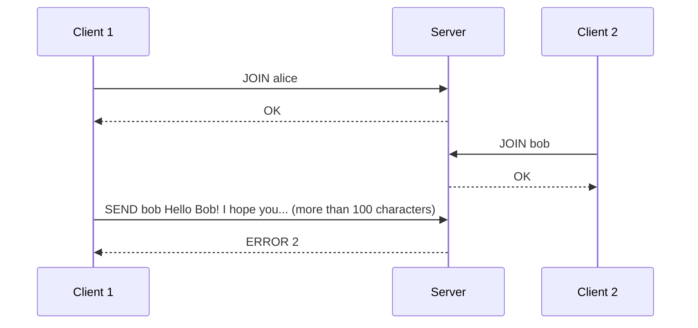
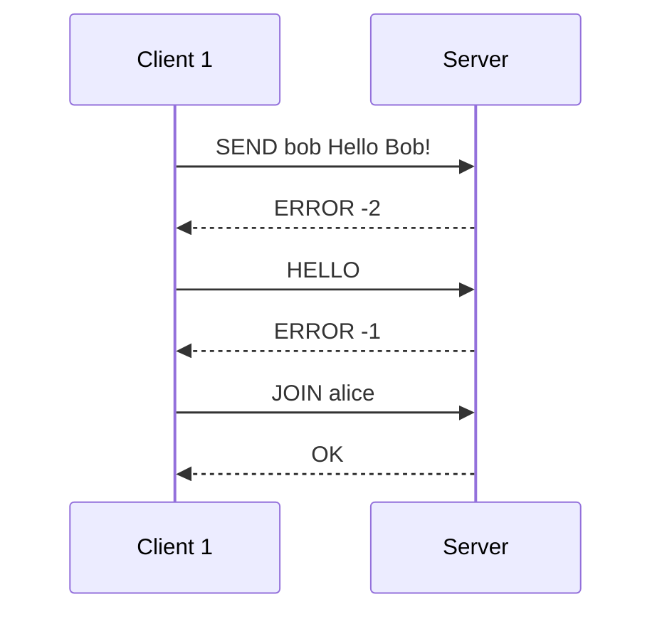

# The Short Message Service (SMS) protocol

> You are working for a startup that wants to create a new communication
> app. The app is simple: it allows users (with unique usernames) to
> send small text messages (maximum 100 characters) to each other. The
> server is in charge of sending the messages to the recipients.
>
> You are asked to define the application protocol that will be used by
> the clients and the server.

Here is one of the possible results.

## Section 1 - Overview

The Short Message Service (SMS) protocol allows users, each with a
unique name, to send short text messages to each other through a
server.

## Section 2 - Transport protocol

The SMS protocol uses TCP, so that no message is lost. The server
listens on port 6435.

Every message is encoded in UTF-8 and ends with a newline character
(`\n`). A message is therefore one line of text, and cannot contain a
newline. Parameters are separated by a single space. Keywords are
written in capitals, and are case-sensitive.

The client opens the connection and speaks first, with a `JOIN`
message. The server checks that the name is free. If it is, the client
has joined; otherwise the server refuses it, and the client can try
another name.

A client that has joined can list the connected users and send a text
message to one of them. The server checks that the recipient is
connected and that the message has at most 100 characters (Unicode code
points). If it is so, the server delivers the message to the recipient;
otherwise it sends an error to the sender.

The server delivers messages as soon as they arrive. A `RECEIVE`
message can therefore reach a client at any time, also while the client
waits for the answer to its own request. A client reads every line and
acts on its keyword.

On an unknown message, or a message with missing or invalid parameters,
the server answers `ERROR -1`. To a valid message other than `JOIN`
from a client that has not joined, it answers `ERROR -2`. In both cases
the connection stays open.

The client leaves by closing the connection. The server then removes it
from the list of connected users.

## Section 3 - Messages

### Join the server

The client asks to join the server under a name.

#### Request

```text
JOIN <name>
```

- `name`: the name of the client, 1 to 20 letters (`a-z`, `A-Z`) and
  digits.

#### Response

- `OK`: the client has joined.
- `ERROR <code>`: the client has not joined. Codes:
  - `1`: the name is already in use.
  - `2`: this client has already joined.

### Unknown or invalid message

The server answers any message it cannot serve.

#### Response

- `ERROR -1`: the message is unknown, or a parameter is missing or
  invalid.
- `ERROR -2`: the message is valid, but the client has not joined yet.

The connection stays open in both cases.

### List connected clients

The client asks for the list of connected clients.

#### Request

```text
LIST
```

#### Response

- `CLIENTS <name1> <name2> <name3> ...`: the names of the connected
  clients, the sender included, separated by a space.

### Send a message

The client sends a text message to another client, through the server.

#### Request

```text
SEND <recipient> <message>
```

- `recipient`: the name of the recipient.
- `message`: the text, at most 100 characters. It may contain spaces:
  it is everything after the second space of the line.

#### Response

- `OK`: the recipient is connected; the server sends it the message.
- `ERROR <code>`: the message was not delivered. Codes:
  - `1`: the recipient is not connected.
  - `2`: the message is longer than 100 characters.

The server checks the codes in this order, and answers the first one
that applies.

### Receive a message

The server delivers a message to its recipient.

#### Request

```text
RECEIVE <sender> <message>
```

- `sender`: the name of the client who sent the message.
- `message`: the text, everything after the second space of the line.

#### Response

None.

## Section 4 - Examples

### Functional example



### Join with a name already in use



### Send a message to a client who is not connected



### Send a message that is too long



### Send before joining, and an unknown message


