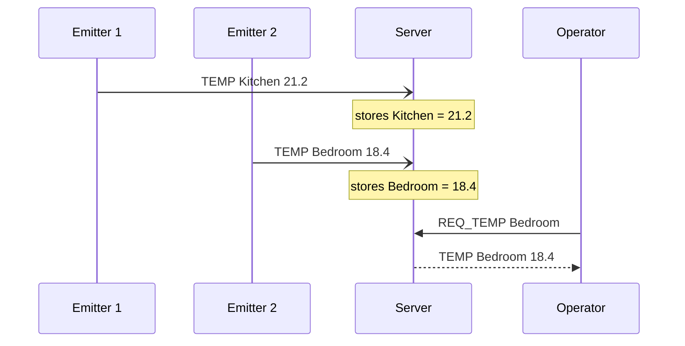
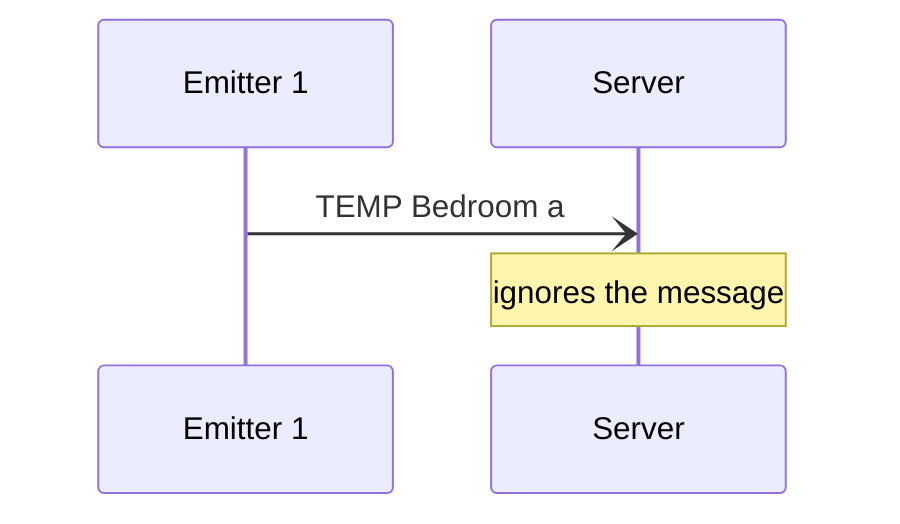
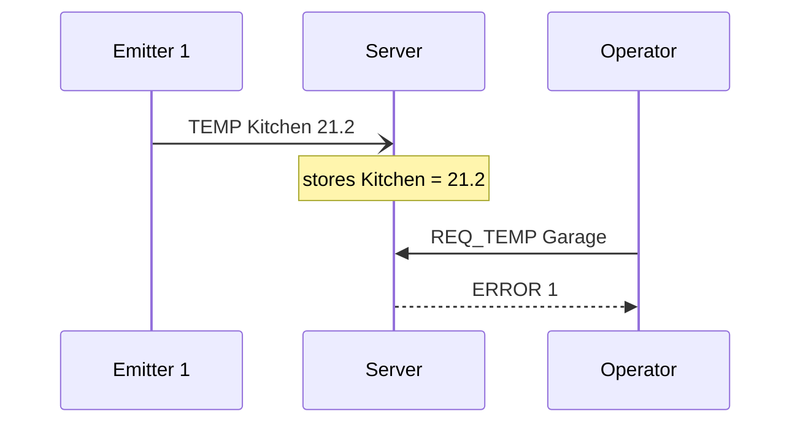
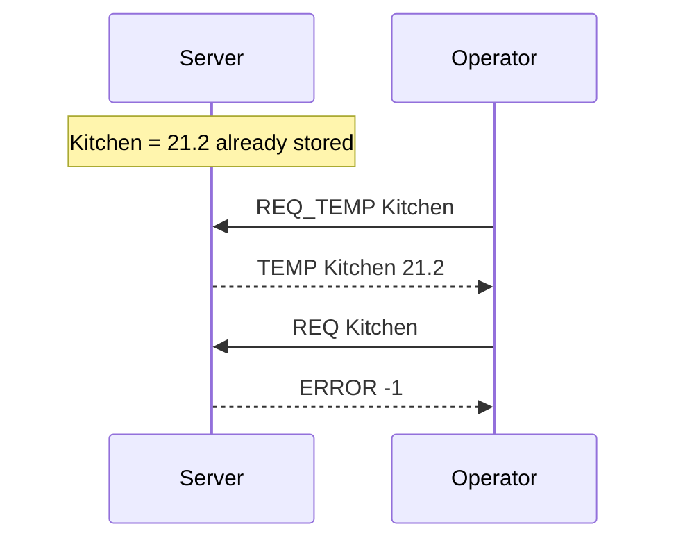

# The *"Temperature monitoring"* protocol

> You are working for an energy company that is interested in
> monitoring the temperature of its buildings. The company wants to
> create a new application called *"Temperature monitoring"*.
>
> The application is simple: each room (customizable) has a temperature
> sensor (an emitter) that emits its own temperature to a receiver (a
> server) on a regular basis (e.g. every 10 minutes).
>
> The server will store the latest temperature of each room.
>
> An operator (client) can connect to the server and request the
> temperature of a specific room. The server will respond with the
> temperature of the room.

Here is one of the possible results. The application works over TCP as
well as over UDP; this specification chooses UDP: a lost measure is
replaced by the next one, ten minutes later.

## Section 1 - Overview

The *"Temperature monitoring"* protocol lets sensors (emitters) send the
temperature of their room to a server at regular intervals, and lets an
operator ask the server for the latest temperature of a room.

## Section 2 - Transport protocol

The protocol uses UDP. Each message is one datagram of at most 256
bytes, encoded in UTF-8, ending with a newline character (`\n`).
Parameters are separated by a single space. Keywords are written in
capitals, and are case-sensitive. A room name has 1 to 20 letters
(`a-z`, `A-Z`) and digits.

**Emitters** send the temperature of their room every 10 minutes, to
the multicast group `239.255.1.2`, port 6436. A multicast group is an
address that any number of receivers can join; every datagram sent to
it reaches all of them. Emitters expect no answer (fire and forget).
The server joins that group, and stores the temperature it receives
for each room, replacing the previous one. Any other message on this
port, or one with an invalid room or temperature, is ignored.

**The operator** sends its requests to the server, in unicast, on port
6437, and the server answers to the address and port the request came
from (request-response). If no answer arrives within 2 seconds, the
operator can send the request again.

On an unknown message from the operator, or a message with missing,
extra or invalid parameters, the server answers `ERROR -1`.

## Section 3 - Messages

### Emit a temperature

An emitter sends the current temperature of its room.

#### Request

```text
TEMP <room> <temperature>
```

- `room`: the name of the room.
- `temperature`: the temperature in degrees Celsius, a decimal number
  with an optional `-` sign, and an optional decimal part written with
  a `.` (`21.5`, `-3.5`, `21`).

#### Response

None.

### Request a temperature

The operator asks for the latest temperature of a room.

#### Request

```text
REQ_TEMP <room>
```

- `room`: the name of the room.

#### Response

- `TEMP <room> <temperature>`: the latest temperature received for the
  room, in the same format as an emitter's message.
- `ERROR <code>`: no temperature is returned. Codes:
  - `1`: no temperature was ever received for this room.

### Unknown or invalid message

#### Response

- `ERROR -1`: the message is unknown, or has missing or extra
  parameters.

## Section 4 - Examples

An arrow with an open head is a multicast message (fire and forget). A
request followed by a dashed answer is unicast (request-response).

### Functional example



### Invalid temperature



### Unknown room



### Unknown message


